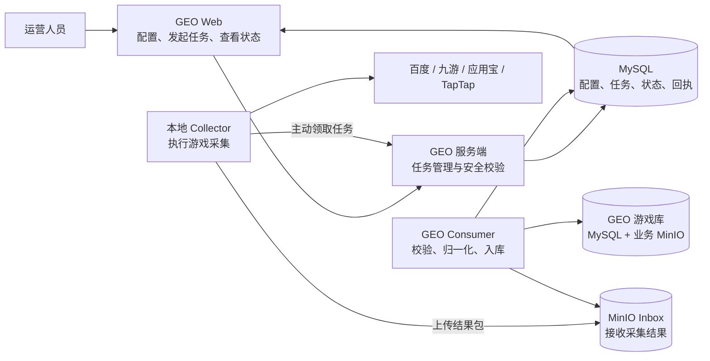

# GEO 外部游戏采集与 Web 联动方案

> 文档状态：方案设计，Web 一键启动尚未开发
>
> 适用读者：产品、研发、测试、运维
>
> 当前范围：本地电脑采集，接入 DEV 环境验证；暂不进入生产环境

## 一、方案概述

GEO 已经具备百度、九游、应用宝和 TapTap 的游戏采集能力，也已经打通了本地电脑到
GEO 服务端的稳定传输和入库流程。

下一步需要解决的问题不是重新开发爬虫，而是让这套能力更容易使用：

- 运营人员可以在 GEO Web 中点击按钮发起采集；
- 不再要求人工打开 PowerShell 执行命令；
- 本地电脑关机或断网时，任务不会丢失；
- 电脑恢复后，采集程序能够继续执行；
- Web 可以查看任务是否等待、运行、上传、入库或失败；
- 采集结果继续使用现有的稳定传输通道。

推荐方案是：Web 负责创建任务，本地 Collector 主动领取任务。

这里的 Collector 指安装在本地电脑上的游戏采集程序。它的工作方式类似一个受控的
本地执行节点，只主动访问 GEO 服务，不接受外部直接连接。

## 二、用户最终会看到什么

### 2.1 发起采集

运营人员在游戏库或 Collector 管理页点击：

- 立即补全一批；
- 立即扩库一批。

Web 创建一条采集任务，并立即显示任务状态。

如果本地电脑在线，Collector 会在短时间内领取任务并开始采集。

如果本地电脑关机、休眠、断网，或者 Collector 没有运行，任务会保持等待。电脑恢复且
Collector 自动启动后，再继续领取和执行。

### 2.2 查看过程

Web 中可以看到：

- 任务由谁发起；
- 使用哪台 Collector；
- 当前是否在线；
- 正在采集哪个来源；
- 采集是否命中；
- 结果是否已经上传；
- GEO 是否已经完成入库；
- 失败发生在哪个阶段；
- 是否可以重试或需要人工处理。

### 2.3 关闭电脑

关闭电脑不会把 Web 中尚未领取的任务标记为失败。

已经开始的任务会依靠本地持久化记录恢复：

- 已经采集完成的内容不会重复采集；
- 已经打包的结果不会重新生成；
- 已经上传的内容会继续等待 GEO 入库；
- 已经入库的内容不会重复产生一份游戏数据。

需要说明：Web 可以保存任务，但不能在电脑完全关机时远程唤醒电脑。电脑开机后，
Collector 才能继续执行。

## 三、整体架构



整个系统分为三部分：

1. 控制：Web 创建任务，GEO 服务端保存任务和配置。
2. 执行：本地 Collector 领取任务并采集游戏内容。
3. 传输与入库：结果上传到 MinIO，Consumer 校验后写入 GEO 游戏库。

## 四、当前已经完成什么

### 4.1 已经完成

- 百度、九游、应用宝、TapTap 四个来源的 Python 采集代码；
- 从 GEO 数据库选择待补全游戏；
- 按 Web 配置决定来源、批量、时间窗和图片数量；
- 本地任务和采集结果持久化；
- 采集结果统一打包；
- 文件和结果包的 SHA-256 完整性校验；
- 失败重试和断点恢复；
- 短期上传授权；
- MinIO Inbox 上传；
- Consumer 独立入库；
- 复用 GEO 的游戏归一化、跨来源合并和图片服务；
- 逐游戏入库回执；
- Collector 节点、运行、传输和入库状态展示；
- DEV 环境下的断网、重启和重复请求测试。

### 4.2 尚未完成

- Web 的“立即补全一批”还没有连接外部 Collector；
- Web 的“立即扩库一批”还没有连接外部 Collector；
- 当前这两个按钮仍会调用 GEO Web 进程内的旧采集代码；
- 本地 Collector 还需要人工执行命令或手工启动常驻 Agent；
- Web 还不能取消一个尚未领取的外部任务；
- 多次未命中后的软删除策略还没有接入新链路；
- TapTap 的部分请求级错误信息还不够详细。

因此，这次 Web 联动属于现有系统的补充，不需要重做采集和传输。

## 五、各部分负责什么

| 部分 | 主要职责 |
| --- | --- |
| GEO Web | 修改采集配置、创建任务、查看进度和结果 |
| GEO 服务端 | 保存任务、选择游戏、控制权限、下发配置、记录状态 |
| 本地 Collector | 领取任务、访问游戏来源、下载图片、打包并上传 |
| MinIO Inbox | 暂存本地 Collector 上传的结果包 |
| GEO Consumer | 校验结果包、归一化数据、写入 MySQL 和业务 MinIO |
| MySQL | 保存配置、任务、运行状态、传输状态和回执 |

一个重要边界是：本地 Collector 不直接连接 GEO MySQL，也不持有业务 MinIO
的长期账号。

游戏选择、归一化、合并、软删除等业务规则仍由 GEO 服务端负责。本地 Collector 只负责
执行已经批准的采集任务。

## 六、使用了哪些技术

### 6.1 本地 Collector

| 技术 | 用途 |
| --- | --- |
| Python | 统一运行四个游戏来源的采集代码 |
| HTTPS | 与 GEO 服务端安全通信 |
| Windows Credential Manager | 保存 Collector 凭据 |
| JSON / JSONL | 保存本地状态和结构化日志 |
| Zstandard | 压缩采集结果包 |
| SHA-256 | 校验任务、结果包和文件是否完整 |
| 本地原子文件 | 防止关机或异常退出造成状态文件损坏 |

Collector 的依赖较少，便于先在 Windows 本地运行，后续再迁移到 Linux、Docker
或 Kubernetes。

### 6.2 GEO 服务端

| 技术 | 用途 |
| --- | --- |
| FastAPI | 提供 Collector 和 Web 所需接口 |
| Pydantic | 校验接口数据 |
| SQLAlchemy | 访问 MySQL |
| MySQL | 保存任务、状态和业务数据 |
| MinIO | 接收结果包并保存业务图片 |
| 独立 Consumer 进程 | 处理上传结果，避免阻塞 Web 服务 |

### 6.3 Web

| 技术 | 用途 |
| --- | --- |
| React | 页面和交互 |
| TypeScript | 前端类型和接口约束 |
| Vite | 开发和构建 |
| Collector 管理页 | 查看节点、任务、传输和入库结果 |

## 七、Web 如何启动本地 Collector 的任务

### 7.1 不采用远程调用本地电脑

不建议让 Web 直接访问本地电脑上的某个端口，因为：

- 本地电脑可能处于企业网络、NAT 或防火墙之后；
- IP 地址可能变化；
- 电脑关机时调用一定失败；
- 开放本地端口会增加安全风险；
- 需要额外处理证书、鉴权和网络入口；
- 容易重新依赖远程桌面或人工操作。

### 7.2 采用任务排队

推荐流程：

1. 用户在 Web 点击“立即补全一批”。
2. GEO 服务端从当前游戏库中选择本批目标。
3. GEO 服务端冻结本次配置和目标，创建一条等待任务。
4. 本地 Collector 定期向 GEO 查询是否有自己的任务。
5. Collector 领取任务后，先保存到本地，再确认领取成功。
6. Collector 使用现有采集和传输流程执行。
7. Web 根据任务、运行、传输和入库回执显示进度。

任务保存在 GEO MySQL 中，浏览器关闭不会影响它。

### 7.3 防止重复点击

每次 Web 点击都带一个唯一请求编号。

如果浏览器因为超时重复提交，服务端会返回同一个任务，而不是再创建一批。默认情况下，
同一台 Collector 同一时间只执行一个任务。

这样可以避免：

- 用户双击按钮创建两批任务；
- 页面刷新导致重复提交；
- 网络超时后无法判断是否已经创建成功；
- 同一批游戏被重复采集。

## 八、任务状态如何展示

建议 Web 使用以下状态：

| 状态 | 产品含义 |
| --- | --- |
| 等待本地节点 | 任务已保存，但 Collector 离线 |
| 等待领取 | Collector 在线，正在等待领取 |
| 已领取 | Collector 已获得任务并保存到本地 |
| 采集中 | 正在访问游戏来源并下载内容 |
| 上传中 | 正在把采集结果上传到 MinIO |
| 入库中 | Consumer 正在校验和写入 GEO |
| 已完成 | 结果已成功处理 |
| 采集失败 | 来源访问或本地执行失败 |
| 入库失败 | 结果校验或服务端写入失败 |
| 已取消 | 用户取消或任务超过有效期 |

Web 应当把一次任务的以下信息关联起来：

```text
Web 请求 -> Job -> Run -> Bundle -> Transfer -> 入库回执
```

用户不需要理解这些技术编号，但研发和运维可以使用它们定位问题。

## 九、关机和异常情况下如何处理

| 情况 | 系统行为 |
| --- | --- |
| 电脑关机，Web 创建任务 | 任务保存在 GEO，等待电脑上线 |
| Collector 未运行 | Web 显示节点离线，任务继续等待 |
| 采集过程中关机 | 开机后从本地记录恢复 |
| 采集完成但还未上传 | 继续上传，不重新采集 |
| 上传过程中断网 | 网络恢复后继续同一份结果 |
| GEO 服务暂时不可用 | 本地保留结果并按规则重试 |
| Consumer 中途退出 | 恢复后跳过已经入库的项目 |
| Web 重复提交 | 返回原任务，不创建重复任务 |

为了防止几天前的旧任务突然执行，建议任务默认保留24小时。Web 可以显示过期时间，并允许
用户在任务尚未执行时取消或延长。

这个默认时间需要产品确认。如果业务希望任务一直等待，也可以改为不过期，但仍应提供
取消和陈旧任务提醒。

## 十、稳定性如何保证

### 10.1 幂等

幂等的含义是：同一请求重复执行，不会产生多份逻辑结果。

当前方案通过以下方式保证：

- Web 请求有唯一编号；
- 每个任务、运行、结果包和传输都有唯一编号；
- 任务内容生成后不再变化；
- Collector 先保存任务，再确认领取；
- 上传重试复用同一份结果包；
- Consumer 为每个游戏保存唯一回执；
- GEO 入库继续使用已有的 `upsert_game` 合并能力。

### 10.2 失败重试

系统只对适合重试的问题进行有限重试，例如：

- 网络连接失败；
- 请求超时；
- 临时服务端错误；
- 短期上传授权过期；
- MySQL 或 MinIO 暂时不可用。

身份错误、文件损坏、格式错误和权限错误不会无限重试，而会记录原因并等待人工处理。

TapTap 返回 403、405 或 429 时会停止本轮 TapTap 采集，不使用代理轮换或其它绕过方式。

### 10.3 完整性校验

采集结果会经过多层检查：

1. 任务配置有 SHA-256；
2. 整个结果包有 SHA-256；
3. 包内每个文件有 SHA-256；
4. Gateway 在上传完成时检查对象；
5. Consumer 入库前再次独立校验；
6. 最终回执必须与原传输编号和结果包哈希一致。

只有完整、身份一致的结果才会进入 GEO 游戏库。

## 十一、日志如何处理

日志分为两层。

本地 Collector 保存：

```text
<collector-data>/logs/active.jsonl
<collector-data>/logs/segment-*.jsonl
```

GEO 服务端保存：

- Collector 是否在线；
- 任务和运行状态；
- 采集事件；
- 传输状态；
- 每个游戏的入库结果；
- 失败分类和脱敏后的错误信息。

`/collector-management` 页面展示的是服务端集中记录，不是直接读取本地日志文件。

日志中不能保存：

- Collector 凭据；
- 数据库账号；
- MinIO 密钥；
- Cookie 或 XSRF；
- 完整预签名链接；
- 未处理的原始响应内容。

当前日志结构预留了接入 OpenTelemetry、Loki 或阿里云 SLS 的能力，但第一阶段不要求部署
完整日志平台。

## 十二、开源项目参考

本方案不是直接复制某个开源项目，而是采用了成熟的 Runner 和任务队列模式。

### 12.1 GitLab Runner

GitLab Runner 的工作方式是：服务端保存任务，本地 Runner 主动领取，执行完成后上报结果。

这与本方案最接近。它证明了本地或自建执行节点不需要由 Web 直接连接，也可以完成可靠的
任务下发。

- [GitLab Runner 官方文档](https://docs.gitlab.com/runner/)
- [GitLab Runner 长轮询](https://docs.gitlab.com/ci/runners/long_polling/)

### 12.2 GitHub Actions self-hosted runner

GitHub 的自托管 Runner 同样要求本地 Runner 程序处于运行状态，并通过出站 HTTPS
接收任务。Windows 环境也支持把 Runner 安装为服务。

- [GitHub self-hosted runners](https://docs.github.com/en/actions/reference/runners/self-hosted-runners)
- [开源 actions/runner](https://github.com/actions/runner)

### 12.3 MinIO

MinIO 的预签名上传允许 Collector 上传指定文件，但不需要在本地保存长期 MinIO 账号。

- [MinIO Python Client](https://docs.min.io/aistor/developers/sdk/python/api/)
- [MinIO GitHub](https://github.com/minio)

### 12.4 OpenTelemetry

OpenTelemetry 提供统一的日志和关联信息规范。当前系统的结构化日志为以后接入集中日志平台
保留了空间。

- [OpenTelemetry Logs Data Model](https://opentelemetry.io/docs/specs/otel/logs/data-model/)

## 十三、为什么暂时不引入更多组件

当前只有一台或少量 Collector，现有 MySQL 已经可以保存任务和状态。因此第一阶段不需要
增加 Redis、RabbitMQ、Kafka 或 Temporal。

暂不引入这些组件的原因是：

- 需要额外部署和维护；
- 增加备份、监控和故障处理成本；
- 当前任务量很小；
- 现有 Job、Transfer、回执和本地状态已经覆盖主要可靠性需求。

未来 Collector 数量或任务量明显增加时，可以增加长轮询或专用任务队列，但不需要改变
采集结果和传输协议。

## 十四、实施建议

### 第一步：Web 任务队列

- Web 创建外部采集任务；
- 本地 Collector 主动领取；
- Web 显示等待和执行状态；
- 支持取消未领取任务；
- 外部模式下，旧 Web 采集线程不再启动。

### 第二步：本地自动启动

- 提供一次性安装命令；
- 使用 Windows 计划任务在用户登录后自动启动 Collector；
- 运行失败后自动重启；
- 不启动 Docker、WSL、浏览器或远程桌面。

如果后续要求未登录也运行，再评估 Windows Service。

### 第三步：业务和日志补齐

- 在 GEO 服务端接入多次全源未命中的处理策略；
- 补充 TapTap 请求阶段、状态码和重试记录；
- 增加失败告警和人工处理入口。

### 第四步：生产准备

- 单独配置生产 Gateway、Collector 身份和 MinIO Inbox；
- 完成生产 TLS、凭据轮换、备份和告警；
- 低频灰度验证；
- 获得明确授权后再切换生产。

## 十五、验收标准

Web 一键联动完成后，应至少满足：

1. 点击一次只创建一个任务。
2. 本地电脑离线时，任务保持等待而不是失败。
3. 电脑恢复后，Collector 能自动领取任务。
4. 浏览器关闭不影响任务执行。
5. 采集、上传或入库过程中异常退出，恢复后不会丢失结果。
6. Web 能看到从任务创建到最终入库的完整状态。
7. 重复请求不会产生重复游戏或重复图片。
8. 日志不泄露凭据和敏感内容。
9. 外部模式下，Web 按钮不会启动旧进程内爬虫。
10. 本地 Collector 不监听外部访问端口，也不依赖远程桌面。

## 十六、实施前需要确认

目前推荐以下默认选择：

| 问题 | 推荐方案 |
| --- | --- |
| 本地电脑离线时能否创建任务 | 可以，Web 提示“等待本地节点” |
| 任务等待多久 | 默认24小时，可取消或延长 |
| 谁可以发起任务 | operator 和 admin |
| 一台 Collector 同时执行几个任务 | 第一阶段只执行一个 |
| 什么时候确定本批游戏 | Web 点击时冻结 |
| Web 入口放在哪里 | 游戏库提供业务入口，Collector 管理页提供运维入口 |
| Windows 如何自动运行 | 第一阶段使用用户登录后的计划任务 |

这些选择确认后，即可把方案拆成正式开发任务。
